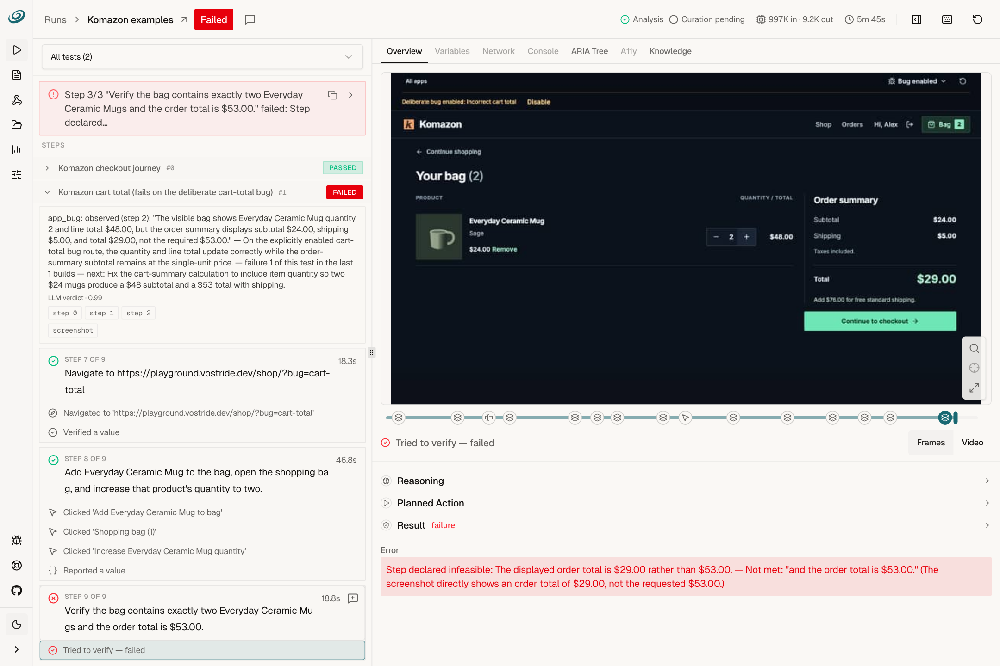

# agent-qa: application testing with persistent memory

## Summary

agent-qa by vostride tests web, Android and iOS apps through CLI/MCP. It combines persistent memidex memory with validated self-improvement and reviewable run evidence for development and QA workflows.

## Key Points

- Web, Android and iOS application testing through CLI/MCP.
- Persistent memidex memory across test runs.
- Validated self-improvement with reviewable run evidence.

## Pros and Cons

| Pros | Requirements and costs |
|---|---|
| Fits CLI and MCP development workflows | Requires Node.js 24+, project setup and model authentication |
| Preserves evidence for reviewing test results | Model and external-service costs vary; license: FSL-1.1-ALv2 |

## Example

The public demo above identifies a deliberately incorrect cart total and shows the failed assertion alongside screenshots and step evidence.

## URL Address of the AI Topic / Vendor

[agent-qa — Official Site](https://vostride.com) · [Repository](https://github.com/vostride/agent-qa) · [Setup](https://vostride.com/docs/agent-qa/quickstart) · [Memory](https://vostride.com/docs/agent-qa/memory) · [Self-improvement](https://vostride.com/docs/agent-qa/self-improvement)
